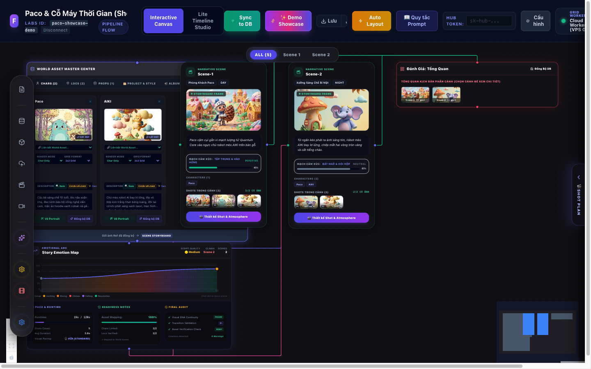
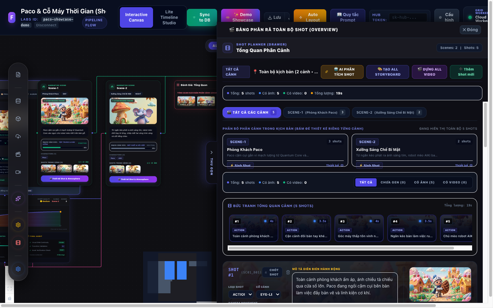
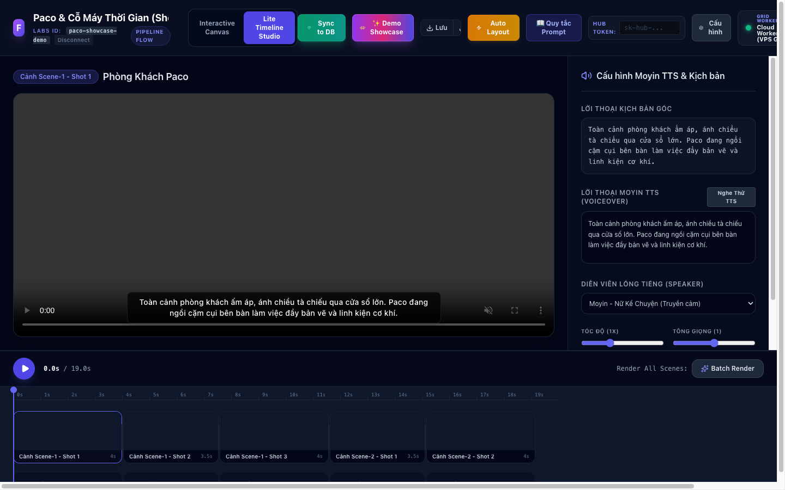
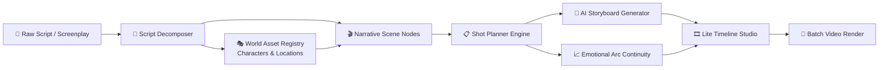

# 🎬 Storyboard Workflow (Flow Architect)

> **Visual Storyboard Workflow & Shot Planner for AI Filmmaking**  
> *Node-based Narrative Architecture, Emotional Continuity Engine & Multi-track Timeline Studio.*

[](https://storyboard-workflow.vercel.app)
[](https://react.dev/)
[](https://www.typescriptlang.org/)
[](https://reactflow.dev/)
[](https://tailwindcss.com/)
[](LICENSE)

---

## 🌟 Live Demo & Instant Showcase

- 🌐 **Production URL:** [https://storyboard-workflow.vercel.app](https://storyboard-workflow.vercel.app)
- ⚡ **One-Click Showcase:** Click the **`✨ Demo Showcase`** button on the top navigation bar to instantly load the full production project (*"Paco & Cỗ Máy Thời Gian"*):
  - 2 Character DNA Anchors (Paco & AIKI).
  - 2 Narrative Scenes (Scene-1: Phòng Khách Paco, Scene-2: Xưởng Sáng Chế Bí Mật).
  - 5 High-resolution generated storyboard shots with cinematic camera framing.
  - Emotional Arc continuity curve & Audit report.
  - Full multi-track video timeline with TTS voiceover preview.

---

## 📸 Interface Showcase

### 1. Interactive Node-based Storyboard Canvas
Visualizes narrative structure, character anchors, scene flow, and emotional pacing on an infinite vector canvas.



### 2. Shot Planner Drawer & Multi-Scene Decomposition
Deep-dive shot breakdown panel featuring scene switching tabs (`All`, `Scene-1`, `Scene-2`), camera angle controls, Seedance 2.0 prompt guidance, and AI storyboard generation.



### 3. Lite Timeline Studio & Moyin TTS Integration
Sequence shots into a playable video timeline, preview voiceovers with Moyin TTS speaker models, and burn animated subtitles.



---

## 🚀 Key Features

### 🧩 1. Node-Based Narrative Flow Architecture
- **Infinite Canvas Workspace:** Powered by `@xyflow/react` with custom nodes for characters, scenes, shot plans, and emotional graphs.
- **Narrative Scene Nodes:** Track scene setting (Day/Night, Location), character attendance, action prompts, and generated storyboard keyframes.
- **Interactive Minimap & Auto-Layout:** Reorganize sprawling storylines into clean cinematic pipelines with a single click.

### 👤 2. World Asset Master Center
- **Character DNA Continuity:** Locks consistent visual identity for characters across scenes using LoRA anchor references and 2x2 grid views.
- **Asset Verification Check:** Live indicator ensuring all characters appearing in scene prompts are properly anchored in the asset registry.
- **Bi-directional DB Sync:** Synchronize scene models and storyboard assets with PostgreSQL via the centralized World Asset DB adaptor.

### 🎬 3. Visual Shot Planner (Drawer & Canvas Node)
- **Granular Decomposition:** Breaks script scenes down into atomic production shots with camera angles (`wide_shot`, `medium_shot`, `close_up`, `over_the_shoulder`), movement directives, and shot durations.
- **Quick Scene Filtering:** Instant tab filtering (`🎬 Tất cả (5)`, `SCENE-1 (3)`, `SCENE-2 (2)`) to switch context seamlessly without losing the big picture.
- **Seedance 2.0 Prompt Standard:** Embedded best-practice guide for authoring high-fidelity AI video generation prompts.

### 📈 4. Emotional Arc & Continuity Audit
- **Narrative Tension Graph:** Real-time visual curve tracking dramatic beats across Setup, Inciting Incident, Rising Action, Climax, and Resolution.
- **Pacing & Runtime Budgeting:** Monitors total project duration, shot counts, and visual pacing (Fast / Medium / Slow).
- **Automated Continuity Gate:** Validates character consistency, transition safety, and prompt hygiene before rendering.

### 🎞️ 5. Lite Timeline Studio
- **Multi-Track Playback:** Composite shot keyframes and generated video clips into a sequential video cut.
- **Moyin TTS & Subtitle Integration:** Configure AI voiceover actors (speed, pitch, emotion) and preview synchronized subtitles on the video canvas.

---

## 🏗️ Architecture & Pipeline Flow



---

## 🛠️ Tech Stack

| Domain | Technologies |
|---|---|
| **Framework & Core** | React 19, TypeScript 5.x, Vite |
| **Canvas & Nodes** | `@xyflow/react` (React Flow v12), `@dagrejs/dagre` |
| **Styling & UI** | Tailwind CSS v3, Lucide React, Radix UI Primitives |
| **State Management** | Zustand, React Hooks, LocalStorage Persist |
| **Media & Audio** | HTML5 Canvas, Web Audio API, Moyin TTS Adaptor |
| **Deployment** | Vercel Edge Platform |

---

## 💻 Getting Started

### Prerequisites
- Node.js >= 18.0.0
- npm >= 9.0.0

### Installation

1. **Clone the repository:**
   ```bash
   git clone https://github.com/zuzziQ/storyboard-workflow.git
   cd storyboard-workflow
   ```

2. **Install dependencies:**
   ```bash
   npm install
   ```

3. **Start local development server:**
   ```bash
   npm run dev
   ```
   Open [http://localhost:5173](http://localhost:5173) in your browser.

4. **Build for production:**
   ```bash
   npm run build
   ```

---

## 📦 Project Structure

```
flow-architect/
├── docs/
│   └── screenshots/              # High-resolution portfolio showcase images
│       ├── canvas-full.png
│       ├── canvas-overview.png
│       ├── shot-planner-drawer.png
│       └── timeline-studio.png
├── src/
│   ├── components/               # Common UI widgets (modals, buttons, badges)
│   ├── features/
│   │   ├── canvas/               # React Flow canvas, node types, edges
│   │   ├── scene/                # Narrative scene nodes & metadata
│   │   ├── shot-plan/            # Shot planner drawer, shot cards, filters
│   │   ├── timeline/             # Lite Timeline Studio, player, Moyin TTS
│   │   ├── assets/               # World Asset Center, character cards
│   │   └── emotional-arc/        # Story emotion map & continuity audit
│   ├── hooks/                    # Reusable state and flow hooks
│   ├── types/                    # TypeScript interfaces & domain models
│   ├── App.tsx                   # Main layout container & top header
│   └── main.tsx                  # React 19 entry point
├── package.json
├── tailwind.config.js
├── tsconfig.json
└── vite.config.ts
```

---

## 📄 License

Distributed under the **MIT License**. See `LICENSE` for more information.

---

## 👨‍💻 Author

Crafted by **Zuzzi** ([@zuzziQ](https://github.com/zuzziQ)) — Architecting next-generation AI generative filmmaking workflows.
